# Arena plan — participant mode

| wave | model | what | in parallel |
|---|---|---|---|
| 1 | Haiku + Sonnet | `lib-hash` + 100 cards (cr-01, cr-02, cr-03, cr-04, cr-06 wait for `lib-hash`) | up to 8 |
| 2 | Sonnet | category page + score table | 2 |
| 3 | Sonnet | integration and full suite; cards that fail twice are redone in Sonnet | 1+ |
| 4 | Opus | security and quality review, final verdict | 1 |

Cryptography (`lib-hash` + cr-01, cr-02, cr-03, cr-04, cr-06): **Sonnet**. To change it: `/demo-plan --crypto haiku`.

```mermaid
flowchart LR
  hash["lib-hash<br/>Sonnet"]
  pw_01["pw-01<br/>Haiku"]
  pw_01 --> pages
  pw_02["pw-02<br/>Haiku"]
  pw_02 --> pages
  pw_03["pw-03<br/>Haiku"]
  pw_03 --> pages
  pw_04["pw-04<br/>Haiku"]
  pw_04 --> pages
  pw_05["pw-05<br/>Haiku"]
  pw_05 --> pages
  pw_06["pw-06<br/>Haiku"]
  pw_06 --> pages
  pw_07["pw-07<br/>Haiku"]
  pw_07 --> pages
  pw_08["pw-08<br/>Haiku"]
  pw_08 --> pages
  pw_09["pw-09<br/>Haiku"]
  pw_09 --> pages
  pw_10["pw-10<br/>Haiku"]
  pw_10 --> pages
  ph_01["ph-01<br/>Haiku"]
  ph_01 --> pages
  ph_02["ph-02<br/>Haiku"]
  ph_02 --> pages
  ph_03["ph-03<br/>Haiku"]
  ph_03 --> pages
  ph_04["ph-04<br/>Haiku"]
  ph_04 --> pages
  ph_05["ph-05<br/>Haiku"]
  ph_05 --> pages
  ph_06["ph-06<br/>Haiku"]
  ph_06 --> pages
  ph_07["ph-07<br/>Haiku"]
  ph_07 --> pages
  ph_08["ph-08<br/>Haiku"]
  ph_08 --> pages
  ph_09["ph-09<br/>Haiku"]
  ph_09 --> pages
  ph_10["ph-10<br/>Haiku"]
  ph_10 --> pages
  web_01["web-01<br/>Haiku"]
  web_01 --> pages
  web_02["web-02<br/>Haiku"]
  web_02 --> pages
  web_03["web-03<br/>Haiku"]
  web_03 --> pages
  web_04["web-04<br/>Haiku"]
  web_04 --> pages
  web_05["web-05<br/>Haiku"]
  web_05 --> pages
  web_06["web-06<br/>Haiku"]
  web_06 --> pages
  web_07["web-07<br/>Haiku"]
  web_07 --> pages
  web_08["web-08<br/>Haiku"]
  web_08 --> pages
  web_09["web-09<br/>Haiku"]
  web_09 --> pages
  web_10["web-10<br/>Haiku"]
  web_10 --> pages
  rd_01["rd-01<br/>Haiku"]
  rd_01 --> pages
  rd_02["rd-02<br/>Haiku"]
  rd_02 --> pages
  rd_03["rd-03<br/>Haiku"]
  rd_03 --> pages
  rd_04["rd-04<br/>Haiku"]
  rd_04 --> pages
  rd_05["rd-05<br/>Haiku"]
  rd_05 --> pages
  rd_06["rd-06<br/>Haiku"]
  rd_06 --> pages
  rd_07["rd-07<br/>Haiku"]
  rd_07 --> pages
  rd_08["rd-08<br/>Haiku"]
  rd_08 --> pages
  rd_09["rd-09<br/>Haiku"]
  rd_09 --> pages
  rd_10["rd-10<br/>Haiku"]
  rd_10 --> pages
  pv_01["pv-01<br/>Haiku"]
  pv_01 --> pages
  pv_02["pv-02<br/>Haiku"]
  pv_02 --> pages
  pv_03["pv-03<br/>Haiku"]
  pv_03 --> pages
  pv_04["pv-04<br/>Haiku"]
  pv_04 --> pages
  pv_05["pv-05<br/>Haiku"]
  pv_05 --> pages
  pv_06["pv-06<br/>Haiku"]
  pv_06 --> pages
  pv_07["pv-07<br/>Haiku"]
  pv_07 --> pages
  pv_08["pv-08<br/>Haiku"]
  pv_08 --> pages
  pv_09["pv-09<br/>Haiku"]
  pv_09 --> pages
  pv_10["pv-10<br/>Haiku"]
  pv_10 --> pages
  es_01["es-01<br/>Haiku"]
  es_01 --> pages
  es_02["es-02<br/>Haiku"]
  es_02 --> pages
  es_03["es-03<br/>Haiku"]
  es_03 --> pages
  es_04["es-04<br/>Haiku"]
  es_04 --> pages
  es_05["es-05<br/>Haiku"]
  es_05 --> pages
  es_06["es-06<br/>Haiku"]
  es_06 --> pages
  es_07["es-07<br/>Haiku"]
  es_07 --> pages
  es_08["es-08<br/>Haiku"]
  es_08 --> pages
  es_09["es-09<br/>Haiku"]
  es_09 --> pages
  es_10["es-10<br/>Haiku"]
  es_10 --> pages
  cr_01["cr-01<br/>Sonnet"]
  hash --> cr_01
  cr_01 --> pages
  cr_02["cr-02<br/>Sonnet"]
  hash --> cr_02
  cr_02 --> pages
  cr_03["cr-03<br/>Sonnet"]
  hash --> cr_03
  cr_03 --> pages
  cr_04["cr-04<br/>Sonnet"]
  hash --> cr_04
  cr_04 --> pages
  cr_05["cr-05<br/>Haiku"]
  cr_05 --> pages
  cr_06["cr-06<br/>Sonnet"]
  hash --> cr_06
  cr_06 --> pages
  cr_07["cr-07<br/>Haiku"]
  cr_07 --> pages
  cr_08["cr-08<br/>Haiku"]
  cr_08 --> pages
  cr_09["cr-09<br/>Haiku"]
  cr_09 --> pages
  cr_10["cr-10<br/>Haiku"]
  cr_10 --> pages
  sc_01["sc-01<br/>Haiku"]
  sc_01 --> pages
  sc_02["sc-02<br/>Haiku"]
  sc_02 --> pages
  sc_03["sc-03<br/>Haiku"]
  sc_03 --> pages
  sc_04["sc-04<br/>Haiku"]
  sc_04 --> pages
  sc_05["sc-05<br/>Haiku"]
  sc_05 --> pages
  sc_06["sc-06<br/>Haiku"]
  sc_06 --> pages
  sc_07["sc-07<br/>Haiku"]
  sc_07 --> pages
  sc_08["sc-08<br/>Haiku"]
  sc_08 --> pages
  sc_09["sc-09<br/>Haiku"]
  sc_09 --> pages
  sc_10["sc-10<br/>Haiku"]
  sc_10 --> pages
  mb_01["mb-01<br/>Haiku"]
  mb_01 --> pages
  mb_02["mb-02<br/>Haiku"]
  mb_02 --> pages
  mb_03["mb-03<br/>Haiku"]
  mb_03 --> pages
  mb_04["mb-04<br/>Haiku"]
  mb_04 --> pages
  mb_05["mb-05<br/>Haiku"]
  mb_05 --> pages
  mb_06["mb-06<br/>Haiku"]
  mb_06 --> pages
  mb_07["mb-07<br/>Haiku"]
  mb_07 --> pages
  mb_08["mb-08<br/>Haiku"]
  mb_08 --> pages
  mb_09["mb-09<br/>Haiku"]
  mb_09 --> pages
  mb_10["mb-10<br/>Haiku"]
  mb_10 --> pages
  cs_01["cs-01<br/>Haiku"]
  cs_01 --> pages
  cs_02["cs-02<br/>Haiku"]
  cs_02 --> pages
  cs_03["cs-03<br/>Haiku"]
  cs_03 --> pages
  cs_04["cs-04<br/>Haiku"]
  cs_04 --> pages
  cs_05["cs-05<br/>Haiku"]
  cs_05 --> pages
  cs_06["cs-06<br/>Haiku"]
  cs_06 --> pages
  cs_07["cs-07<br/>Haiku"]
  cs_07 --> pages
  cs_08["cs-08<br/>Haiku"]
  cs_08 --> pages
  cs_09["cs-09<br/>Haiku"]
  cs_09 --> pages
  cs_10["cs-10<br/>Haiku"]
  cs_10 --> pages
  hash --> pages
  pages["wave 2 · Sonnet<br/>categories + score"] --> integration["wave 3 · Sonnet<br/>integration + suite"]
  integration --> review["wave 4 · Opus<br/>review"]
```

## Cost estimate

| type | model | agents | cost per agent | subtotal |
|---|---|---|---|---|
| implementer | Sonnet 5.5 | 8 (+1 retry) | US$ 0.0411 | US$ 0.37 |
| worker | Haiku 5.5 | 95 (+10 retries) | US$ 0.0017 | US$ 0.18 |
| integrator | Sonnet 5.5 | 1 | US$ 0.0247 | US$ 0.0247 |
| reviewer | Opus 5.5 | 1 | US$ 0.30 | US$ 0.30 |
| planner | Opus 5.5 | 1 | US$ 0.0310 | US$ 0.0310 |
| memory-extractor | Haiku 5.5 | 1 | US$ 0.0020 | US$ 0.0020 |
| main session | Sonnet 5.5 | 1 | US$ 0.13 | US$ 2.56 |
| safety margin (15%) | — | — | — | US$ 0.52 |
| **estimated total** | | | | **US$ 3.98** |

Target: US$ 5.00 · cap: US$ 10.00. Within the target. The run is never stopped because of cost.

