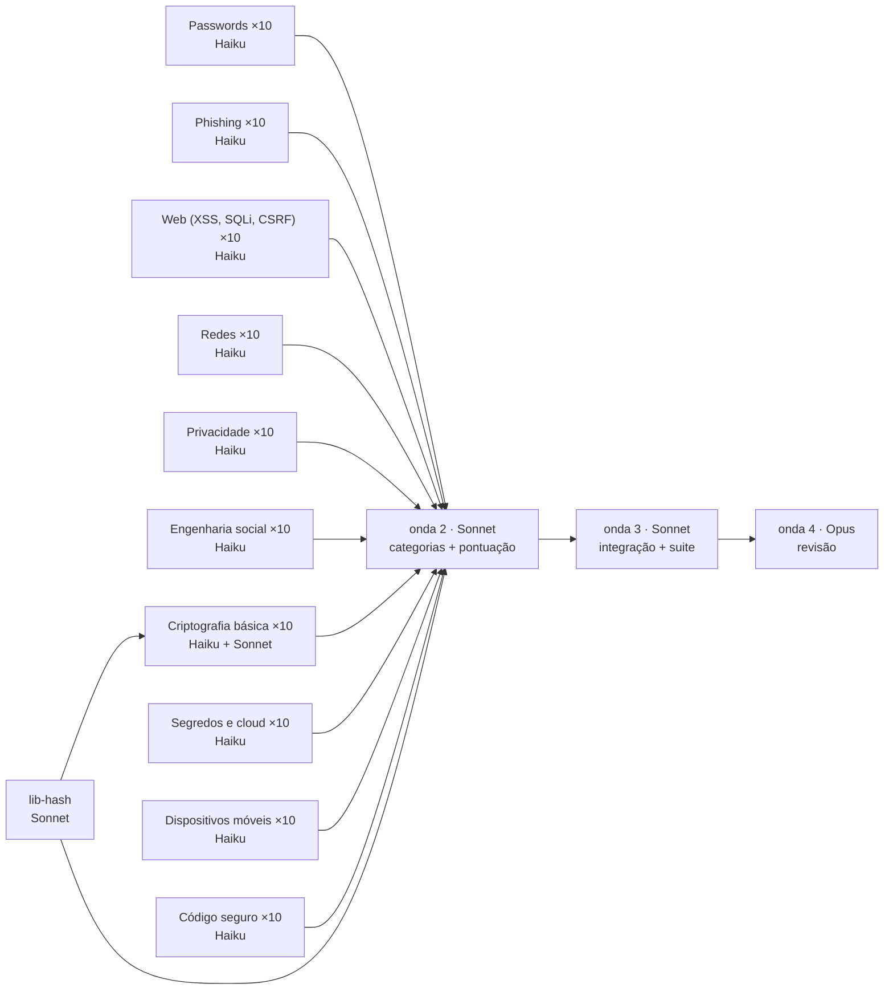

# Plano da Arena — modo apresentador

| onda | modelo | o quê | em paralelo |
|---|---|---|---|
| 1 | Haiku + Sonnet | `lib-hash` + 100 cartões (cr-01, cr-02, cr-03, cr-04, cr-06 esperam pelo `lib-hash`) | até 16 |
| 2 | Sonnet | página de categoria + tabela de pontuação | 2 |
| 3 | Sonnet | integração e suite completa; cartões que falhem 2× são refeitos em Sonnet | 1+ |
| 4 | Opus | revisão de segurança e qualidade, veredito final | 1 |

Criptografia (`lib-hash` + cr-01, cr-02, cr-03, cr-04, cr-06): **Sonnet**. Para mudar: `/demo-plan --crypto haiku`.

## Estimativa de custo

| tipo | modelo | agentes | custo por agente | subtotal |
|---|---|---|---|---|
| implementer | Sonnet 5.5 | 8 (+1 repetições) | US$ 0,0411 | US$ 0,37 |
| worker | Haiku 5.5 | 95 (+10 repetições) | US$ 0,0017 | US$ 0,18 |
| integrator | Sonnet 5.5 | 1 | US$ 0,0247 | US$ 0,0247 |
| reviewer | Opus 5.5 | 1 | US$ 0,30 | US$ 0,30 |
| planner | Opus 5.5 | 1 | US$ 0,0310 | US$ 0,0310 |
| memory-extractor | Haiku 5.5 | 1 | US$ 0,0020 | US$ 0,0020 |
| sessão principal | Sonnet 5.5 | 1 | US$ 0,12 | US$ 1,48 |
| margem de segurança (15%) | — | — | — | US$ 0,36 |
| **total estimado** | | | | **US$ 2,75** |

Alvo: US$ 5,00 · teto: US$ 10,00. Dentro do alvo. A execução nunca é interrompida por custo.

