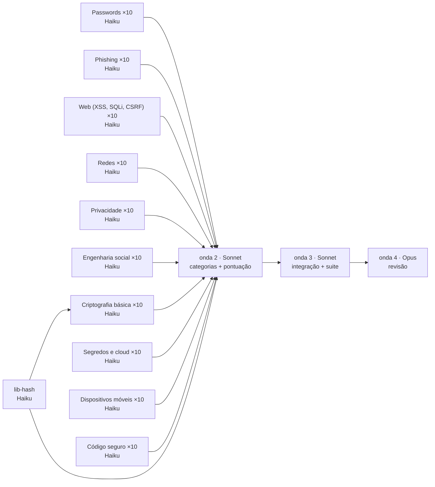

# Plano da Arena — modo apresentador

| onda | modelo | o quê | em paralelo |
|---|---|---|---|
| 1 | Haiku | `lib-hash` + 100 cartões (cr-01, cr-02, cr-03, cr-04, cr-06 esperam pelo `lib-hash`) | até 8 |
| 2 | Sonnet | página de categoria + tabela de pontuação | 2 |
| 3 | Sonnet | integração e suite completa; cartões que falhem 2× são refeitos em Sonnet | 1+ |
| 4 | Opus | revisão de segurança e qualidade, veredito final | 1 |

## Estimativa de custo

| tipo | modelo | agentes | custo por agente | subtotal |
|---|---|---|---|---|
| worker | Haiku 5.5 | 101 (+11 repetições) | US$ 0,0056 | US$ 0,63 |
| implementer | Sonnet 5.5 | 2 | US$ 0,23 | US$ 0,45 |
| integrator | Sonnet 5.5 | 1 | US$ 0,23 | US$ 0,23 |
| reviewer | Opus 5.5 | 1 | US$ 0,31 | US$ 0,31 |
| sessão principal | Sonnet 5.5 | 1 | US$ 0,0575 | US$ 0,98 |
| **total estimado** | | | | **US$ 2,60** |

Alvo: US$ 5,00 · teto: US$ 10,00. Dentro do alvo. A execução nunca é interrompida por custo.

## Ajustes do planner

Mantenho o paralelismo por defeito de 8 em vez de 16: a memória não tem lições sobre erros 429, mas 105 tarefas a 16 em simultâneo aumentam o risco de limites de taxa sem ganho proporcional. Os cartões são unidades pequenas e independentes, adequadas a Haiku, e a 3.ª tentativa já escala automaticamente para Sonnet, o que cobre os casos difíceis sem custo à partida. Não promovo nenhum cartão: mesmo os de criptografia que usam lib-hash só consomem uma biblioteca já pronta, e o risco real está em lib-hash, não nos cartões. As páginas e a integração ficam em Sonnet e a revisão em Opus, onde o raciocínio transversal compensa o custo.

- paralelismo: 8

Riscos:
- Os cartões cr-01, cr-02, cr-03, cr-04 e cr-06 dependem de lib-hash: se lib-hash falhar ou mudar de API, estes 5 cartões bloqueiam ou partem em cascata.
- Sobreposição de temas (ph-07 vs ph-06, web-01 vs cs-06, pw-07 vs pw-03, cr-08 vs pw-04) pode gerar conteúdo duplicado ou contraditório entre agentes independentes.
- Com 100 cartões em Haiku, a consistência de formato e de tom pode variar e só ser detetada tarde, na integração ou na revisão em Opus.
- Os cartões de código (web-*, cs-*) mostram exemplos vulneráveis: risco de exemplos tecnicamente errados ou de código inseguro copiável sem aviso claro.
